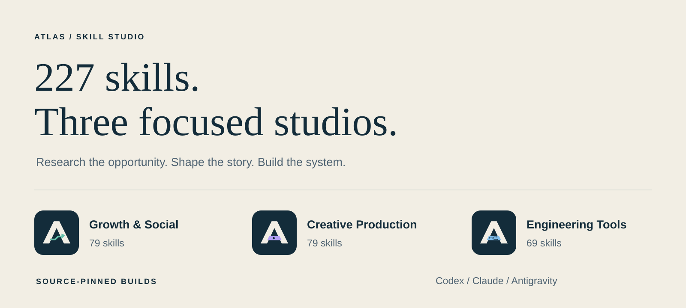
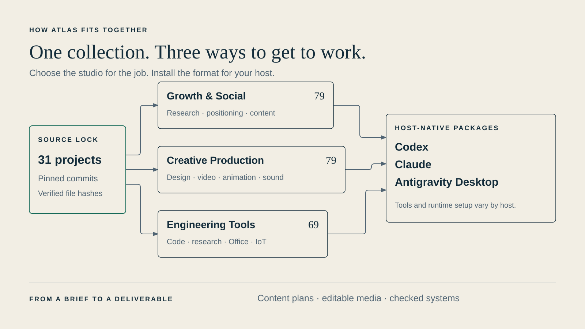

<p align="center"></p>

<p align="center">
  
  
  
  
  <a href="THIRD_PARTY_NOTICES.md"></a>
</p>

<p align="center"><strong>Research the opportunity. Shape the story. Build the system.</strong></p>
<p align="center">227 curated agent skills, organized into three focused studios, with source-pinned builds for Codex, Claude and Antigravity.</p>
<p align="center"><a href="#start-here">Start here</a> · <a href="#choose-your-studio">Explore the studios</a> · <a href="docs/INSTALL.md">Installation guide</a> · <a href="#built-on-the-work-of-others">Upstream credits</a></p>

## What you can make

Turn an audience question into a content plan. Take a video from script and storyboard to an editable render. Move an IoT idea through firmware, wiring diagrams and PCB checks. Atlas groups the workflows and references for that work, so you can choose the studio that fits your task.

The collection brings together **31 pinned upstream skill projects**, two Atlas orchestration/integration guides, and optional application integrations. Original authors retain credit and ownership. Atlas adds organization, cross-host packaging, reproducible assembly and a clearer entry point.

## Choose your studio

| Studio | Skills | Reach for it when you need… | Example request |
|---|---:|---|---|
| **Growth & Social** | **79** | Audience and competitor research, positioning, SEO, copywriting, campaigns and LinkedIn/social workflows | “Research this audience and build a four-week content plan. Separate evidence from assumptions.” |
| **Creative Production** | **79** | UI/UX, diagrams, scripts, storyboards, video, animation, 3D, voice, music, sound and captions | “Use creator-production to make a 30-second vertical product video from my screenshots and licensed audio.” |
| **Engineering Tools** | **69** | Planning, debugging, TDD, code review, academic research, Office, embedded systems, wiring and PCB design | “Use Ponytail to fix this bug with the smallest complete change and run the relevant checks.” |



Only the relevant skills should load for a task. Installing a studio does not mean every workflow runs at once. You can name an exact skill—such as `creator-production`, `ponytail` or `academic-research-suite`—when you want a particular approach.

## Start here

**Requirements:** Python 3.10+, Git, internet access, and the host application you want to use. The installer uses Python’s standard library; an npm package or `npx` command is not required. Optional production tools are separate.

```sh
git clone https://github.com/bangaji313/atlas-skill-studio.git
cd atlas-skill-studio
```

Choose one destination:

| Destination | Command / next step |
|---|---|
| **Antigravity Desktop / App** | `python atlas.py install antigravity` → restart the App → Customizations → Installed |
| **Claude Code** | `python atlas.py install claude` |
| **Codex desktop / CLI** | `python atlas.py install codex` |
| **Claude Desktop, Chat or Cowork** | `python atlas.py build` → open the reported build directory → upload the three `*-claude-1.3.0.zip` files through Claude’s custom-plugin interface |
| **Inspect packages without installing** | `python atlas.py build` |

On Windows, `py -3` can replace `python`; on macOS/Linux, use `python3` if needed. Start with a single studio using `--studio growth`, `--studio creative` or `--studio engineering`. For example:

```sh
python atlas.py install antigravity --studio creative
```

The first build fetches pinned source content from upstream using Git partial/sparse checkout, verifies file hashes, applies the recorded adaptations, and creates host-specific plugin directories and ZIPs. Cached sources are reused. Keep the clone and the successful build directory: CLI marketplaces reference the generated local packages. See [installation, updates and recovery](docs/INSTALL.md).

### Prefer to ask your agent?

Give an execution-capable agent this prompt:

> Install Atlas Skill Studio from https://github.com/bangaji313/atlas-skill-studio for **Antigravity Desktop**. Read README.md, docs/INSTALL.md, THIRD_PARTY_NOTICES.md and atlas.py first. Use the documented installer, install the Creative studio, verify its 79 skill entrypoints, and report which optional runtimes or services still need setup. Do not install paid services or copy credentials.

Replace the host and studio as needed. A URL in an ordinary chat is a reference, not a persistent plugin installation. Claude Chat/Desktop may require a custom-plugin upload and the appropriate plan or organization permissions.

## A real, small production example

[Watch the two-scene Hypit sample with audio](docs/assets/hypit-two-scenes.mp4). This original synthetic fixture was rendered locally at 360×640, 30 fps, with two distinct named windows; all 10 specification checks passed. It demonstrates an actual render path, not a promise that every provider or full production workflow has been tested.


The reference environment also passed **109 OpenMontage contract/regression tests**, a local FFmpeg editing smoke test, and post-migration discovery of all **227 unique skills**. [Read the verification boundaries](docs/VERIFICATION.md).

## What installation gives you

- The selected skill instructions, local references, helpers and upstream notices.
- Separate Codex, Claude and Antigravity manifests, with three studios in each format.
- A source lockfile recording repositories, commits, source paths and output hashes.
- Build-time integrity checks and local packages you can inspect before installing.

Renderer environments, CAD applications, model weights, API credentials, subscriptions and credits require separate setup. Skills can guide a workflow; the host still needs the tools and permissions to execute it. Hooks, global behavior injection and automatic MCP-server registration are not added by this distribution.

## Built on the work of others

Atlas is an independent curation and integration project. It is not affiliated with or endorsed by the source maintainers, OpenAI, Anthropic or Google. “Curated” does not mean every source is independently security-certified or ranked as a top repository.

<details>
<summary><strong>All upstream skill projects and optional application integrations</strong></summary>

| Source repository | Author / organization | Atlas use | License / scope |
|---|---|---|---|
| [ahujasid/mcp-for-blender](https://github.com/ahujasid/mcp-for-blender) | [@ahujasid](https://github.com/ahujasid) | Blender MCP integration | External integration; see upstream |
| [aklofas/kicad-happy](https://github.com/aklofas/kicad-happy) | [@aklofas](https://github.com/aklofas) | Engineering Tools | MIT |
| [antoinebou12/uml-skill](https://github.com/antoinebou12/uml-skill) | [@antoinebou12](https://github.com/antoinebou12) | Engineering Tools | MIT |
| [blader/humanizer](https://github.com/blader/humanizer) | [@blader](https://github.com/blader) | Growth & Social | MIT |
| [calesthio/OpenMontage](https://github.com/calesthio/OpenMontage) | [@calesthio](https://github.com/calesthio) | Creative Production, Engineering Tools | AGPL-3.0 / embedded notices |
| [cathrynlavery/diagram-design](https://github.com/cathrynlavery/diagram-design) | [@cathrynlavery](https://github.com/cathrynlavery) | Creative Production | MIT |
| [coreyhaines31/marketingskills](https://github.com/coreyhaines31/marketingskills) | [@coreyhaines31](https://github.com/coreyhaines31) | Creative Production, Growth & Social | MIT |
| [DietrichGebert/ponytail](https://github.com/DietrichGebert/ponytail) | [@DietrichGebert](https://github.com/DietrichGebert) | Engineering Tools | MIT |
| [elevenlabs/skills](https://github.com/elevenlabs/skills) | [@elevenlabs](https://github.com/elevenlabs) | Creative Production | MIT |
| [heygen-com/hyperframes](https://github.com/heygen-com/hyperframes) | [@heygen-com](https://github.com/heygen-com) | Creative Production | Apache-2.0 / component notices |
| [hypit-ai/hypit](https://github.com/hypit-ai/hypit) | [@hypit-ai](https://github.com/hypit-ai) | Creative Production | Modified Apache-2.0 |
| [Imbad0202/academic-research-skills-codex](https://github.com/Imbad0202/academic-research-skills-codex) | [@Imbad0202](https://github.com/Imbad0202) | Engineering Tools | CC BY-NC 4.0 |
| [img2threejs/img2threejs](https://github.com/img2threejs/img2threejs) | [@img2threejs](https://github.com/img2threejs) | Creative Production | Apache-2.0 / component notices |
| [iOfficeAI/OfficeCLI](https://github.com/iOfficeAI/OfficeCLI) | [@iOfficeAI](https://github.com/iOfficeAI) | Engineering Tools | Apache-2.0 / component notices |
| [Jeffallan/claude-skills](https://github.com/Jeffallan/claude-skills) | [@Jeffallan](https://github.com/Jeffallan) | Engineering Tools | MIT |
| [jordan-gibbs/hyperresearch](https://github.com/jordan-gibbs/hyperresearch) | [@jordan-gibbs](https://github.com/jordan-gibbs) | Engineering Tools | MIT |
| [lemomo-ai/lemo-opuscar](https://github.com/lemomo-ai/lemo-opuscar) | [@lemomo-ai](https://github.com/lemomo-ai) | Creative Production | MIT |
| [Leonxlnx/taste-skill](https://github.com/Leonxlnx/taste-skill) | [@Leonxlnx](https://github.com/Leonxlnx) | Creative Production | MIT |
| [mattpocock/skills](https://github.com/mattpocock/skills) | [@mattpocock](https://github.com/mattpocock) | Engineering Tools | MIT |
| [miqdadbadjuber/anti-slop](https://github.com/miqdadbadjuber/anti-slop) | [@miqdadbadjuber](https://github.com/miqdadbadjuber) | Creative Production, Engineering Tools, Growth & Social | MIT |
| [nextlevelbuilder/ui-ux-pro-max-skill](https://github.com/nextlevelbuilder/ui-ux-pro-max-skill) | [@nextlevelbuilder](https://github.com/nextlevelbuilder) | Creative Production | MIT |
| [NVIDIA/SkillSpector](https://github.com/NVIDIA/SkillSpector) | [@NVIDIA](https://github.com/NVIDIA) | Engineering Tools | Apache-2.0 / component notices |
| [obra/superpowers](https://github.com/obra/superpowers) | [@obra](https://github.com/obra) | Engineering Tools | MIT |
| [pbakaus/impeccable](https://github.com/pbakaus/impeccable) | [@pbakaus](https://github.com/pbakaus) | Creative Production | Apache-2.0 / component notices |
| [penpot/penpot](https://github.com/penpot/penpot) | [@penpot](https://github.com/penpot) | Penpot design-session MCP integration | External integration; see upstream |
| [Potapovrg/kicad-skill](https://github.com/Potapovrg/kicad-skill) | [@Potapovrg](https://github.com/Potapovrg) | Engineering Tools | MIT |
| [remotion-dev/remotion](https://github.com/remotion-dev/remotion) | [@remotion-dev](https://github.com/remotion-dev) | Creative Production | Remotion License |
| [salomonMuriel/media-production-skills](https://github.com/salomonMuriel/media-production-skills) | [@salomonMuriel](https://github.com/salomonMuriel) | Creative Production | MIT |
| [ScrapeCreators/social-media-research-skills](https://github.com/ScrapeCreators/social-media-research-skills) | [@ScrapeCreators](https://github.com/ScrapeCreators) | Growth & Social | MIT |
| [sergebulaev/linkedin-skills](https://github.com/sergebulaev/linkedin-skills) | [@sergebulaev](https://github.com/sergebulaev) | Growth & Social | MIT |
| [TauricResearch/TradingAgents](https://github.com/TauricResearch/TradingAgents) | [@TauricResearch](https://github.com/TauricResearch) | Optional research application integration | External integration; see upstream |
| [titanwings/distilly](https://github.com/titanwings/distilly) | [@titanwings](https://github.com/titanwings) | Engineering Tools | MIT |
| [tt-a1i/archify](https://github.com/tt-a1i/archify) | [@tt-a1i](https://github.com/tt-a1i) | Engineering Tools | MIT |
| [Vincentwei1021/video-shotcraft](https://github.com/Vincentwei1021/video-shotcraft) | [@Vincentwei1021](https://github.com/Vincentwei1021) | Creative Production | Apache-2.0 / component notices |

</details>

The full [skill catalog](docs/CATALOG.md) maps every skill to its studio and upstream author. [The lockfile](catalog/atlas.lock.json) records exact commits and file provenance; it is the build source of truth.

### Respect the component licenses

Atlas-authored code and docs use MIT. Third-party patches, overlays and assembled packages keep their component licenses. In particular, ARS is noncommercial, Hypit has additional distribution/service conditions, OpenMontage is AGPL, and Remotion has its own terms. Stock media has separate usage conditions. **This is not an all-MIT bundle or a blanket commercial-use license.** Read [Third-party notices](THIRD_PARTY_NOTICES.md) before using or redistributing components.

Upstream source archives, renderer binaries, stock-media libraries, dependency folders and private account/plugin data are not committed here. Builds retrieve the selected source files locally. Review asset provenance before using any bundled upstream media in a production.

## Documentation

| Guide | Contents |
|---|---|
| [Installation](docs/INSTALL.md) | Desktop versus CLI, ZIP upload, prerequisites, updates and recovery |
| [Catalog](docs/CATALOG.md) | All 227 skills and their sources |
| [Runtime guide](docs/RUNTIME.md) | Local applications, providers, rendering and host limitations |
| [Verification](docs/VERIFICATION.md) | What passed, what remains untested, and how to repeat local checks |
| [Discovery notes](docs/DISCOVERY.md) | Positioning, repository topics and source-based discoverability decisions |
| [Contributing](CONTRIBUTING.md) | Proposing updates while preserving attribution and source locks |

Found a missing reference, host-format issue or stale source? [Open an issue](https://github.com/bangaji313/atlas-skill-studio/issues) with the host/version, studio and a redacted error. Please send improvements back to the original projects when they belong upstream.
